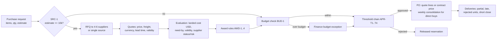

# Procure-to-Pay Synthetic Data Generator

This is a reproducible, rule-driven simulation of a procurement workflow: purchase requests,
budget checks, threshold approvals, RFQs with competing supplier quotes, landed-cost comparison,
award, purchase orders and supplier deliveries. It generates linked data with valid keys,
event history and documented exceptions. Injected anomalies are labelled in a separate ground-truth
file, and a validator checks the whole dataset (547 checks) on every build.

* **Pure Python standard library.** No dependencies to generate, validate or export. `pytest` is only needed for the tests.
* **One generator for every size.** `--scale starter` (10%) and `--scale full` (the brief's volumes) share all code.
* **Fixed seed `20261022`.** Two runs produce byte-identical files (SHA-256 checked).

## Quick start

```bash
python --version                              # 3.10 or newer (built and tested on 3.14)
python -m procurement_synth all               # starter + full: generate, validate, reproduce, docs
python -m pytest -q                           # 9 end-to-end tests (pip install pytest)
```

Individual steps:

```bash
python -m procurement_synth generate --scale full --seed 20261022   # -> data/full
python -m procurement_synth generate --scale full --no-anomalies --out /tmp/clean   # clean baseline
python -m procurement_synth validate --data data/full               # -> data/full/reports/
python -m procurement_synth reproduce --scale full                  # generate twice, compare with each other and data/full
python -m procurement_synth docs                                    # regenerate docs/data_dictionary.md
```

The full build takes about 10 seconds.

## Results at a glance (full scale, seed 20261022)

| Entity | Brief | Generated | How the count is controlled |
|---|---:|---:|---|
| Requesters | 300 | 300 | exact (master data) |
| Suppliers | 120 | 120 | exact (master data) |
| Purchase requests | 1,200 | 1,200 | exact (1,172 genuine + 28 injected duplicates / split purchases) |
| RFQs | 500 | 500 | exact: demand mix puts 500 requests in the RFQ band; RFQ creation is rule SRC-1 |
| Supplier quotes | 1,500 | 1,500 | exact: supplier responses are allocated, the award is still computed by rules |
| Purchase orders | 900 | 918 | **rule outcome** (rejections, cancellations, open work, consolidation); reported, tolerance 5% |

| Check | Result |
|---|---|
| Validation suite (`data/full/reports/validation_summary.md`) | **PASS**: 547 checks, 0 failing |
| Reproducibility (`reports/reproducibility.md`) | 58 files identical across two runs and to the shipped copy in `data/full` |
| Clean baseline (`reports/baseline_check.json`) | 0 control findings, 0 illegal transitions |
| Control checks vs ground truth (`reports/metrics.md`) | 65 labels, precision 1.0 and recall 1.0 for all 8 types |

Process KPIs (from `data/full/reports/metrics.md`):

| | | | |
|---|---:|---|---:|
| PR -> PO conversion | 84.8% | Competitive RFQs with >= 3 quotes | 96.5% |
| Rejected / cancelled requests | 9.6% / 2.7% | Awards to lowest eligible landed cost | 94.1% |
| Over-budget requests | 53 | Savings vs requester estimate | 12.1% |
| Budget exceptions approved / rejected | 21 / 25 | First delivery on time | 75.0% |
| Single-source share of RFQs | 7.8% | POs with partial delivery or short close | 19.9% |

## Workflow



Every decision is recorded: `approval` rows (rule id, approver, reason), `quote_evaluation`
(landed cost, eligibility, rank), `rfq_award` (basis and rationale), `budget_transaction` (append-only
ledger), `status_event` (full lifecycle history) and `exception_register` (documented exceptions
with reasons). The rules are written up in [docs/business_rules.md](docs/business_rules.md).

## Data model

27 tables. Every table has a primary key, and every relationship has a foreign key that is
enforced in the SQL seed and re-checked by the validator.

| Group | Tables |
|---|---|
| Master / reference | `department`, `requester` (self-referencing manager chain), `item_category`, `item`, `supplier`, `fx_rate`, `budget` |
| Effective-dated history | `supplier_status_history`, `supplier_risk_flag` |
| Bridges (N:M) | `supplier_category`, `rfq_supplier`, `po_line` (request <-> PO) |
| Transactions | `purchase_request`, `request_line`, `rfq`, `supplier_quote`, `quote_line`, `rfq_award`, `purchase_order` |
| Events | `approval`, `delivery`, `delivery_line`, `budget_transaction`, `status_event` |
| Derived | `quote_evaluation`, `budget_balance`, `exception_register` |

* ERD, cardinalities and state machines: [docs/erd.md](docs/erd.md)
* Data dictionary (type, required, allowed values, unit, uniqueness and rule for every column),
  generated from `schema.py`: [docs/data_dictionary.md](docs/data_dictionary.md)
* Pipeline walkthrough (stage -> file map, glossary, one request traced end to end):
  [docs/pipeline.md](docs/pipeline.md)
* Step-by-step run guide with expected output and troubleshooting: [docs/HOW_TO_RUN.md](docs/HOW_TO_RUN.md)
* Every point of the problem statement mapped to its evidence, including the evaluation focus,
  distributions and actors: [docs/requirements_coverage.md](docs/requirements_coverage.md)

ID conventions follow the brief: `PR-2026-000001`, `RFQ-2026-000001`, `QUO-SUP0001-2026-000001`
(global counter), `PO-2026-000001`, `DEL-PO-2026-000001-01`. Child lines append `-Lnn`. IDs are
assigned in event-time order and never change.

## Scenario coverage

| Brief item | Where it shows up |
|---|---|
| Single-source exceptions | 39 `SINGLE_SOURCE` RFQs (OEM-only items, emergencies) with Procurement Director approval |
| Over-budget requests | 53 `OVER_BUDGET` checks: Finance approves within transfer caps, rejects otherwise |
| Split purchases | 5 labelled groups (2-3 requests just under the $5k tier) |
| Quote expiry | 52 quotes excluded as `EXPIRED` at evaluation (legitimate) + 8 labelled expired awards |
| Supplier risk flags | 41 effective-dated flags. HIGH blocks invitation and award; MEDIUM can trigger a risk-mitigation award; delivery and quality flags worsen performance |
| Partial deliveries | 2-3 shipment POs, inspection rejections with replacements, 28 short-closed POs |
| Boundary cases | Tier edges, competition waivers (only 2 bids), requests still open at the snapshot. Awards are withdrawn if the supplier deactivates before the PO (rule implemented; no case occurs with the default seed). |

### Required negative scenarios (ground truth)

| Issue type | Labels (full) | Control rule |
|---|---:|---|
| `PO_WITHOUT_APPROVAL` | 10 | PO only after every approval step is approved |
| `QUOTE_EXPIRED_AT_AWARD` | 8 | Awarded quote valid on the award date |
| `NON_LOWEST_AWARD_NO_RATIONALE` | 10 | Non-lowest award needs a documented basis |
| `INACTIVE_SUPPLIER` | 6 | PO supplier ACTIVE on the PO date |
| `BUDGET_OVERRUN` | 6 | Over-budget spend needs an approved exception |
| `DUPLICATE_REQUEST` | 14 | Same requester, category and lines within 10 days |
| `QUOTE_CURRENCY_MISMATCH` | 6 | PO currency = awarded quote currency |
| `SPLIT_PURCHASE` | 5 | No splitting to stay under a threshold |

Labels live only in `data/<scale>/ground_truth/` (CSV and JSON), with the evidence values and the
expected handling. The input tables carry no flag columns, and the validator checks that.

## Acceptance criteria and how they are verified

| Criterion | Verification (all in `validation_summary.md`) |
|---|---|
| Approval thresholds enforced | tier = band of the approval basis; completed chains cover every required level; approvers hold the authority and never approve themselves; steps are sequential |
| Supplier selection is explainable | `quote_evaluation` recomputes landed cost, eligibility and rank; non-lowest awards carry a basis and rationale; unexplained cases are exactly the labelled ones |
| PO values equal awarded quote lines | every RFQ PO line matches its quote line (quantity, unit price, request line), plus freight; direct POs = list price x (1 - contract discount) |
| Budget reservation is consistent | balances = sum of the ledger; reservation held only while a request is open; re-based at award; commitment = PO value less short-close release; transfers net to zero and tie to approved exceptions |
| Every exception has a reason and audit trail | reason codes on decisions, cancellations, disqualifications, awards and register rows; lifecycle chains are continuous |

The suite also covers primary-key uniqueness, foreign keys (including polymorphic ones), enums,
ID formats, natural-key duplicates, date ordering, arithmetic reconciliation, lifecycle
continuity, volumes, ground-truth separation, JSON = CSV, and loading `schema.sql` + `seed.sql`
into SQLite with foreign keys enforced.

## How the data is generated

1. **Master data**: departments, a 300-person org chart (CEO -> VPs -> directors -> managers -> staff, with buyers and controllers), 14 categories, 172 items, 120 suppliers with category coverage, contract ranks, effective-dated status and risk, and a monthly FX table.
2. **Demand**: 1,200 requests with seasonality, role and department weights, category affinity, quantities fitted to the value band, priorities, need-by dates and justifications. Duplicates and split purchases are injected here.
3. **Budgets**: sized from forecast demand with a tightness factor, plus a contingency pool.
4. **Sourcing plan**: invitations, quotes, evaluation and award (rules AWD-1..4) depend only on inputs and effective-dated master data.
5. **Process simulation**: a discrete-event engine processes submissions, budget checks, approval steps, PO runs, deliveries and short-closes strictly in time order up to the snapshot, so every budget check sees the ledger as it was at that moment.
6. **Finalize**: statuses come from the last event, balances from the ledger, and the exception register from the records.
7. **Baseline, then injection**: a clean run counts anomaly opportunities, then the injected run applies the plan. Both use the same per-entity random streams (`random.Random(f"{seed}|entity|key")`), so the only differences are the labelled cases and their natural consequences.
8. **Export** CSV, JSON, SQL (SQLite/PostgreSQL), ground truth and a manifest with SHA-256 checksums. Then **validate** and **reproduce**.

## Outputs

```
data/<scale>/
  csv/<table>.csv          27 input tables
  json/<table>.json        same rows as JSON arrays
  sql/schema.sql           DDL with PK, FK, UNIQUE, CHECK
  sql/seed.sql             INSERTs in dependency order (one transaction)
  ground_truth/            ground_truth.csv / .json (never mixed into inputs)
  manifest.json            seed, command, rules, params, provenance, row counts, SHA-256 per file
  reports/                 validation_summary, metrics, control_findings, baseline_check, reproducibility
```

## Provenance and lawful use

All data is synthetic. No external dataset was downloaded, scraped or transformed. People and
company names are random combinations of generic words, e-mail addresses use the reserved
`example.com` domain, and FX rates are a synthetic random walk from illustrative starting values,
not market data. Any resemblance to real people or companies is coincidental. Details are in the
`provenance` block of each `manifest.json`, which also records each external-source field the brief
asks for (source URL, dataset version, retrieval date, licence/terms, attribution, transformations,
fields discarded) as not applicable. Code and data are released under the MIT licence.

## Assumptions and limitations

* Single legal entity, USD base currency. RFQs request USD bids, but foreign suppliers may quote in
  their own currency, which is converted at the quote month's rate.
* Requests hold a single category. Contract (direct-buy) suppliers are domestic and price in USD.
* No invoices, payments or three-way match. Delivery acceptance is the end of the modelled flow.
* No public holidays. Supplier behaviour (price level, responsiveness, on-time and defect rates) comes from latent parameters that are deliberately not exported.
* The PO count is an outcome of the rules rather than a quota, so it varies slightly by seed (899-918 across the seeds tested).
* Control checks mirror the injection rules, so 100% precision and recall shows that the labels and the data are consistent. It is not a benchmark of a learned detector. The labelled set is meant to be used for that.

## Repository layout

```
procurement_synth/   generator package (config, schema, master, demand, budget, sourcing,
                     engine, orders, anomalies, finalize, export, validate, checks_domain,
                     controls, metrics, docs, cli)
tests/               end-to-end pytest suite
docs/                business_rules.md, erd.md, pipeline.md, HOW_TO_RUN.md,
                     requirements_coverage.md, data_dictionary.md (generated)
data/starter, data/full   generated datasets and reports
```
