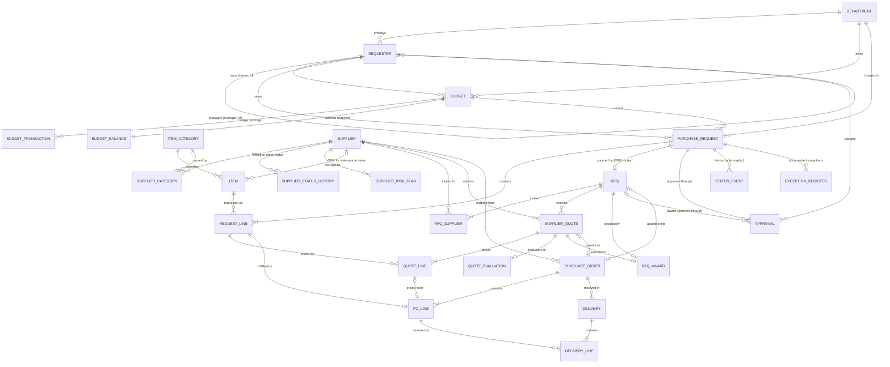
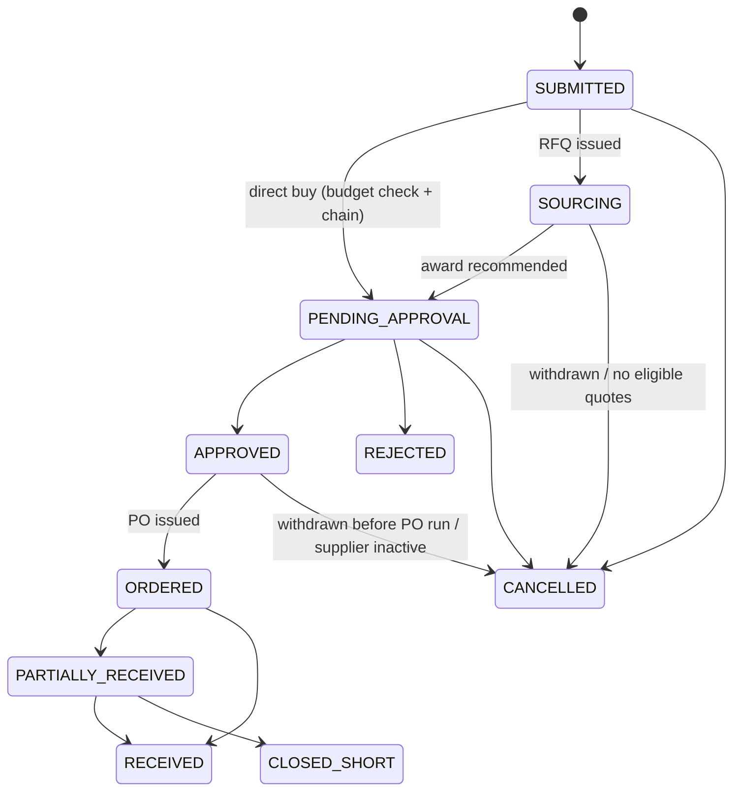
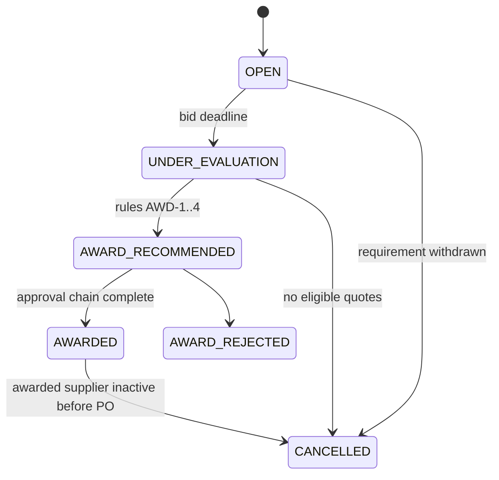
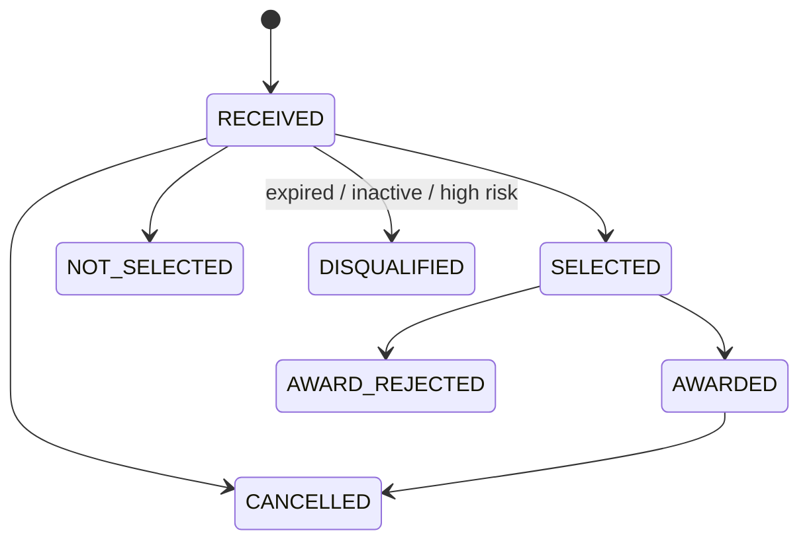
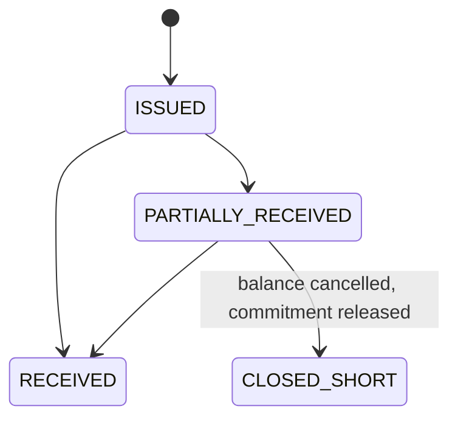

# Entity-relationship model and lifecycles

GitHub renders the diagrams below. The full column list, cardinality table and validation rules
are in [data_dictionary.md](data_dictionary.md).

## Entity-relationship diagram

### Many-to-many relationships and their bridges

| Relationship | Bridge | Notes |
|---|---|---|
| Supplier <-> Category | `supplier_category` | Carries the contract preference rank and discount |
| RFQ <-> Supplier | `rfq_supplier` | Invitation and response status; every quote must have an invitation row |
| Purchase request <-> Purchase order | `po_line` | One row per ordered request line. Direct-buy POs consolidate several requests; each request line is ordered at most once (`po_line.pr_line_id` is unique). |

### Polymorphic references

`budget_transaction.source_id` (by `source_type`), `status_event.entity_id` (by `entity_type`) and
`exception_register.entity_id` (by `entity_type`) point at different tables. SQL cannot enforce
these, so `validate.py` resolves every one of them.

## Lifecycle state machines

`status_event` stores every transition, and each entity's `status` column equals its last event.
The validator checks chain continuity (`from_status` = previous `to_status`, times non-decreasing).
`controls.py` checks the whitelists below. The only transitions outside them are the labelled
`PO_WITHOUT_APPROVAL` cases (`PENDING_APPROVAL -> ORDERED`).

### Purchase request

### RFQ

### Supplier quote and purchase order

Supplier status (`ACTIVE`, `SUSPENDED`, `INACTIVE`) and risk flags are effective-dated: each row
has an interval, and every decision (invitation, evaluation, PO) is checked against the status
on its own date.

## Effective-dated records

| Table | Validity columns | Used for |
|---|---|---|
| `supplier_status_history` | `effective_from`, `effective_to` (half-open; null = current) | Supplier must be `ACTIVE` on the invitation, evaluation and PO dates |
| `supplier_risk_flag` | `raised_date`, `cleared_date` (null = open) | An open HIGH flag blocks invitation and award; MEDIUM can trigger AWD-3; delivery and quality flags worsen performance |
| `requester` | `hire_date`, `termination_date` | Requester must be employed on the submission date; deliveries are received by the requester only while employed |
| `budget` | `effective_from`, `effective_to` | FY2026 budget period |
| `supplier_category` | `effective_from` | Date the supplier was approved for the category |
| `department` | `effective_from` | Date the department record became effective |
| `fx_rate` | `rate_month` | Quote month rate at evaluation; issue month rate on the PO |

`supplier.status` and `supplier.risk_rating` are snapshot values derived from the history tables
at `AS_OF`. Decisions never use them.
